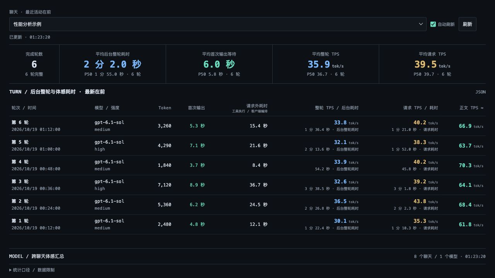

# Codex TPS Dashboard

一个只读的本地仪表盘，用于分析 Codex Desktop 聊天的整轮耗时、首次输出等待和 TPS。项目仅使用 Python 标准库，数据留在本机。



## 功能

- 查看每轮耗时、Token、首次输出等待及多种 TPS 指标。
- 按聊天、模型和思考强度汇总性能数据。
- 合并拆分的 rollout，并按分叉历史还原当前可见轮次。
- 自动排除子代理和审批聊天；缺失数据统一显示 `—`。

## 使用

需要 macOS、Codex Desktop 和 Python 3.9 或更高版本。

```sh
git clone https://github.com/zenvor/codex-tps-dashboard.git
cd codex-tps-dashboard
python3 codex_tps.py --open
```

也可以在 Finder 中双击 `launch-dashboard.command`。服务默认运行在 <http://127.0.0.1:8765>，在终端按 `Ctrl+C` 停止。

## 命令行参数

| 参数 | 说明 |
| --- | --- |
| `--codex-home PATH` | Codex 数据目录，默认为 `~/.codex` |
| `--thread UUID` | 首次打开时选择的聊天 |
| `--port PORT` | 监听端口，默认为 `8765` |
| `--open` | 启动后打开浏览器 |
| `--export FILE` | 导出所选聊天的 JSON 后退出 |

```sh
python3 codex_tps.py --thread 00000000-0000-4000-8000-000000000001 --export stats.json
```

只读 JSON 接口为 `/api/threads`、`/api/stats?thread=<UUID>` 和 `/api/models`。

## 指标

| 指标 | 含义 |
| --- | --- |
| 后台整轮耗时 | 从任务开始到完成的总时间，包含模型请求、工具执行和客户端编排 |
| 首次输出等待 | 从任务开始到首次可见输出的时间 |
| 整轮 TPS | 全部输出 Token ÷ 后台整轮耗时 |
| 请求 TPS | 全部输出 Token ÷ 可配对的模型请求耗时 |
| 请求外耗时 | 后台整轮耗时减去模型请求耗时 |
| 正文 TPS ≈ | 可分离正文请求的近似输出速度 |

概览显示已完成轮次的平均值和 P50。日志缺失、请求无法配对或轮次未完成时，不计算相应指标。

> Codex Desktop 的“工作了 X 分 X 秒”可能在最终回答开始时停止，而后台整轮耗时包含最终回答输出，因此两者可能不同。

## 数据与隐私

项目以只读方式读取 `~/.codex/state_5.sqlite`、`~/.codex/logs_2.sqlite`、`~/.codex/sessions/` 和 `~/.codex/archived_sessions/`，只监听 `127.0.0.1`，不会上传日志。

页面和导出的 JSON 可能包含聊天标题、模型、时间及性能数据。公开前请先检查内容。

## 测试

```sh
PYTHONDONTWRITEBYTECODE=1 python3 -m unittest -v test_codex_tps.py
```
